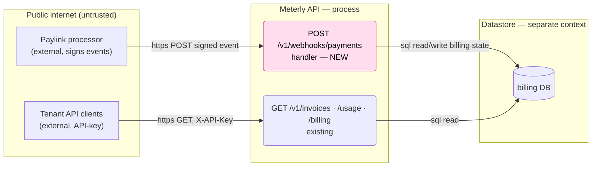
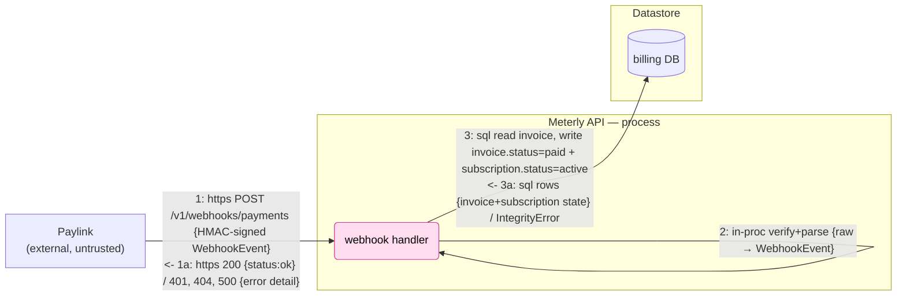
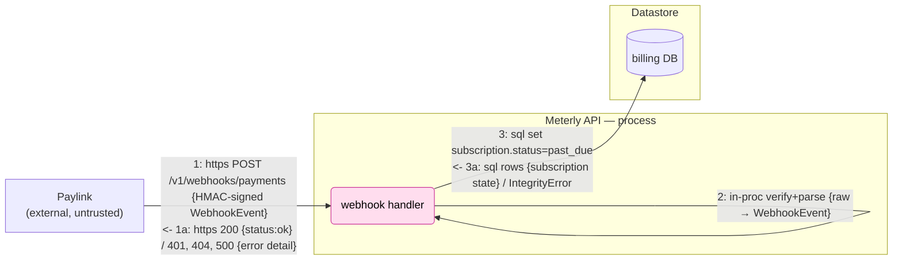

# Threat Model — Meterly Paylink payment webhook

Sample output of the `threat-model` skill, run against [`SPEC.md`](SPEC.md) + [`app/`](app).
Scoped to the change that adds the inbound Paylink webhook. In a real repo this lives at
`docs/threat-modelling/paylink_webhook/`.

## Scope

- **Base:** `main`. **Change:** adds `app/webhooks.py` (new `POST /v1/webhooks/payments`) and
  `app/schemas.py` (`WebhookEvent`/`WebhookData`), wired in `app/main.py`.
- **Summary:** Paylink (a third-party payment processor) calls a new public, internet-reachable
  endpoint to report `invoice.paid` / `invoice.payment_failed`. Requests carry an HMAC-SHA256
  signature over the raw body, keyed by `PAYLINK_WEBHOOK_SECRET`. The handler verifies the
  signature, loads the invoice by id, and mutates invoice + subscription state.
- **Trust-relevant surface:** a new unauthenticated (signature-only) ingress that writes the
  authoritative billing system-of-record.

**Context diagram (Level 0):**

In-scope node (pink) = what the change adds. `PL`, `TEN`, `RD`, `DB` are neighbors, drawn for
orientation. Each `subgraph` is one execution context (process / network / store); every edge
between them crosses a trust boundary.

## Use Cases

| UC | Description | Primary actor | Lifecycle phase |
|---|---|---|---|
| UC1 | Paylink reports a **successful** payment (`invoice.paid`) → mark invoice paid + subscription active | Paylink (external) | In use |
| UC2 | Paylink reports a **failed** payment (`invoice.payment_failed`) → mark subscription past_due | Paylink (external) | In use |

Both share one code path; they are split because the abuse differs (UC1 = revenue/entitlement
fraud, UC2 = billing sabotage). Deploy/Admin/Decommission phases: **n/a** for this change.

## Use-Case Analysis

### UC1 — invoice.paid

| ID | Attacker | Attack | Impact | Severity | Status | Countermeasure | Verification |
|---|---|---|---|---|---|---|---|
| UC1:1-Sa | Anonymous internet (Critical) | **Fail-open secret.** `os.environ.get("PAYLINK_WEBHOOK_SECRET", "")` (`webhooks.py:21`) defaults to `""`; the HMAC is then computed over an empty key, which anyone can reproduce over any body → any forged event is accepted. | Auth bypass on the billing system-of-record; forge arbitrary events → integrity loss + cross-tenant writes — Critical | **Critical** | `[OPEN]` | Fail **closed** when the secret is unset/empty (refuse to start, or reject all); verify HMAC over the raw body with `hmac.compare_digest`. | add: test that missing/empty secret → reject; tampered body → 401. |
| UC1:1-D | Anonymous internet (Critical) | **Unauthenticated, unthrottled, unbounded.** No rate limit (`main.py`), and the whole body is buffered + HMACed before any size check (`webhooks.py:19-22`); each accepted call does a DB write. | DoS of the `/v1` service (CPU on HMAC, DB locks on one SQLite file) — Medium | **High** | `[OPEN]` | Gateway rate limit on `/v1`; in-app max-body-size cap before hashing. | add: oversized body → 413; load test. (rests on A2) |
| UC1:3-E | Compromised trusted dependency / Paylink (Low) | **Global invoice id, no binding to caller.** `db.get(Invoice, event.data.invoice_id)` (`webhooks.py:27`) selects any invoice by sequential PK (`models.py`); an event can name **any tenant's** invoice (no ownership binding) and flip its subscription `active`. | Writes across the tenant boundary — tenant-isolation break — Critical | **High** | `[OPEN]` | Bind the event to the loaded invoice's owner (as UC1:3-T) — caps the blast radius even if Paylink is compromised. Auth hardening (UC1:1-Sa) removes the anonymous path; see 6d. | add: covered by UC1:1-Sa / UC1:3-T tests. |
| UC1:1-Sb | Anonymous internet (Critical) | **Non-constant-time compare.** `x_paylink_signature != expected` (`webhooks.py:23`) is a short-circuiting compare, not `hmac.compare_digest` — a timing side-channel on the hex digest. | Forged signature for a chosen body would be an auth bypass, but a remote timing oracle on a fixed-length HMAC hex compare is not practically exploitable — *requires implausible conditions* (Low) | **Medium** | `[OPEN]` | Use `hmac.compare_digest`. | review: constant-time compare in place. |
| UC1:1-R | Compromised trusted dependency (Low) | **No audit trail.** Authoritative billing writes (`webhooks.py:31-37`) log nothing — not event id, signature outcome, invoice, or transition. | Repudiation; no forensics for billing disputes or forged-event incidents — durable repudiation of billing events — High | **Medium** | `[OPEN]` | Append-only audit row per request (event id, signature outcome, source ip, invoice, transition). | add: test asserts an audit row on both accept and reject. → 6c |
| UC1:3-T | Compromised trusted dependency / Paylink (Low) | **Event not bound to the invoice.** `subscription_id`, `amount_cents`, `currency` are parsed but never checked against the loaded invoice (`webhooks.py:27-34`); an invoice is marked `paid` regardless of amount. | Mark a high-value invoice paid with zero/partial payment — financial integrity loss — High | **Medium** | `[OPEN]` | Verify `event.data.subscription_id == invoice.subscription_id` and that `amount_cents`/`currency` match before mutating. | add: mismatch → reject; underpayment → not paid. |
| UC1:1a-I | Compromised trusted dependency / Paylink (Low) | **Response oracle + verbose errors.** The return distinguishes 200 `ok`, 404 `invoice not found` (`webhooks.py:29-30`), 401, and an unhandled `ValidationError` → 500 (`webhooks.py:27`); a signed caller can probe which invoice ids exist, and malformed-but-signed bodies crash unhandled. | Existence oracle for sequential invoice ids + error-detail leak — minor info leak (Low). Becomes an anonymous oracle once `1-Sa` is open — composed in 6d, not here. | **Low** | `[OPEN]` | Uniform ack: same generic response whether or not the invoice exists; catch parse errors → 400; keep the detail in the audit trail (`UC1:1-R`), not the response. | add: unknown-invoice vs. malformed-body vs. success responses indistinguishable to the caller. |
| UC1:2-T | Compromised trusted dependency / Paylink (Low) | **`type` is a free-form `str`** (`schemas.py:13`) and the dispatch has no `else` (`webhooks.py:31-35`): unknown types still `commit()` and return `ok`. | Ambiguous/unknown events acked as processed; masks integration errors — Low | **Low** | `[OPEN]` | Constrain `type` to an enum/`Literal`; reject unknown with 400; don't commit on a no-op. | add: unknown type → 400, no commit. |

*Signature findings `UC1:1-Sa/Sb`, audit `UC1:1-R`, DoS `UC1:1-D`, and the response oracle
`UC1:1a-I` apply identically to UC2 edges 1/1a (same code path).*

*Return edge `UC1:3a` (DB rows back into the handler) is dismissed explicitly: a poisoned
response presumes billing-DB compromise, which already owns the system of record; its failure
mode (500 on `IntegrityError`) is the same verbose-error surface as `UC1:1a-I`.*

### UC2 — invoice.payment_failed

| ID | Attacker | Attack | Impact | Severity | Status | Countermeasure | Verification |
|---|---|---|---|---|---|---|---|
| UC2:1, 1a | — | Signature / audit / DoS / response oracle as `UC1:1-Sa/Sb/R/D`, `UC1:1a-I` (shared path). | see UC1 | see UC1 | `[OPEN]` | see UC1 | see UC1 |
| UC2:3-E | Compromised trusted dependency / Paylink (Low) | **Cross-tenant sabotage.** An event naming any tenant's invoice (`webhooks.py:27,35`) forces that subscription `past_due` (no ownership binding). | Degrade/suspend an arbitrary victim tenant's billing — Medium per event | **Low** | `[OPEN]` | Auth (UC1:1-Sa) + binding (UC1:3-T). Fleet-wide sweep escalates in 6d (Chain 3). | add: covered by UC1:1-Sa / UC1:3-T tests. |

*Return edge `UC2:3a`: dismissed as `UC1:3a` (same reasoning, same code path).*

## Findings Summary

- **Status:** 9 findings, all `[OPEN]` (this is a pre-merge review of a new feature).
- **Severity:** Critical ×1 (`UC1:1-Sa`), High ×2 (`UC1:1-D`, `UC1:3-E`), Medium ×3 (`UC1:1-Sb`,
  `UC1:1-R`, `UC1:3-T`), Low ×3 (`UC1:1a-I`, `UC1:2-T`, `UC2:3-E`).
- **Per-edge vs. 6d:** the DB-write findings (`UC1:3-E`/`3-T`, `UC2:3-E`) are scored at their
  **edge-intrinsic** exposure — a compromised Paylink (Low) — per `scoring.md`'s *score-at-the-edge*
  rule; the anonymous/Critical escalation when the fail-open (`UC1:1-Sa`) is open is composed in
  **6d**, not baked into the rows. Only `1-Sa`'s own auth-bypass is Critical at rest.
- **Top fixes before merge:**
  1. **Fail-closed secret + constant-time verify** (`UC1:1-Sa`, `UC1:1-Sb`) — the single
     highest-leverage fix; it severs every 6d chain.
  2. **Bind the event to the invoice** (`UC1:3-T`) — verify subscription/amount/currency.
  3. **Idempotency + audit** (`UC1:1-R`, replay) — an event-id store and an append-only log.
- **Variants / out-of-change leads** (pre-existing, *not* introduced here — surface, don't fix in this PR):
  - **Plaintext API keys** — `auth.py` compares `X-API-Key` by SQL equality; hash at rest, compare in constant time.
  - **`get_billing` cross-tenant IDOR** — `main.py:46-49` selects the globally-first subscription
    and most-recent invoice, ignoring the caller's tenant. Pre-existing, but **6d shows this
    change makes it a reachable confirmation oracle** — worth tracking now.
- **Assumptions** (move severities; verify them):
  - **A1 — TLS terminates at the gateway** for `/v1`. Protects signatures/bodies in transit;
    replay-by-capture presumes this holds.
  - **A2 — a gateway may rate-limit `/v1`.** If present, `UC1:1-D` downgrades; nothing in-app enforces it.
  - **A3 — `PAYLINK_WEBHOOK_SECRET` is set in production.** `UC1:1-Sa` assumes it *may not be* —
    there is no in-code guard, so the fail-open stands as a real finding regardless of deploy intent.

## Cross-Cutting Analysis

**6a — Design synthesis.** Five findings (`UC1:1-Sa`, `UC1:2-T`, `UC1:3-T`, `UC1:3-E`, `UC2:3-E`)
share one root cause: *the handler treats the request as fully trusted after a single, bypassable
HMAC check — no fail-closed posture, and no binding of the event to the invoice it mutates.* Above
the 3-finding threshold, so the right countermeasure is **architectural, not per-row**: a hardened
ingest chokepoint that (1) fails closed on a missing secret and verifies in constant time, (2)
enforces idempotency via the event id, (3) binds `invoice_id`/`subscription_id`/`amount`/`currency`
to the loaded invoice, and (4) writes an audit row — implemented once at the webhook entrypoint.
Subsumes `UC1:1-Sa`, `UC1:2-T`, `UC1:3-T`, `UC1:3-E`, `UC2:3-E`.

**6b — Dependency currency.** Critical-path deps are stdlib `hmac`/`hashlib` (signature) and
`pydantic` (parsing untrusted input). No new third-party crypto. Pin `pydantic` and wire SCA so a
parser advisory on this untrusted-input path is caught; otherwise nothing notable here.

**6c — Detection & observability.** `UC1:1-R` is the case where **detection is the mitigation**: the
endpoint is unauthenticated-by-design (signature only), so a forgery attempt is invisible without a
trail. Emit an append-only audit of every request (accepted and rejected) with event id, signature
outcome, source ip, invoice, and transition; alert on a spike in `rejected:bad_signature` or request
volume. Verification: a test triggers each condition and asserts the signal fires.

**6d — Attack-path synthesis.** The per-edge tables score each DB-write finding at its
**edge-intrinsic** exposure — a compromised Paylink (Low), *assuming the signature holds* — so
`UC1:3-E` is High, `UC1:3-T` Medium, `UC2:3-E` Low. That assumption is exactly what `UC1:1-Sa` (the
fail-open) removes: with no secret, **anyone** forges a valid event, so the effective attacker on
every downstream edge becomes anonymous (Critical exposure). 6d is where that escalation is priced —
deliberately *not* baked into the rows (see `scoring.md`, "Score at the edge; compose in Pass 6d").
Produced by the `threat-model-redteam` agent over the reconciled set:

- **Chain 1 — self-service entitlement forgery (composed Critical).** Hops: `UC1:1-Sa` (Critical) →
  `UC1:2-T` (Low) → `UC1:3-T` (Medium). With the fail-open open the attacker is anonymous and marks
  *their own* open invoice `paid`/`active` with zero payment. Unauthenticated, no MITM. `UC1:3-T`
  rises Medium→Critical in-chain. **Break-point:** fail-closed secret.
- **Chain 2 — cross-tenant takeover (composed Critical).** Hops: `UC1:1-Sa` (Critical) → `UC1:3-E`
  (High) → `UC1:3-T` (Medium): enumerate sequential `invoice_id` 1..N (the 200/404 split on
  `UC1:1a` is the enumeration oracle), reactivate / keep-entitled
  *any* tenant's subscription. **`UC1:3-E` rises High→Critical once `1-Sa` removes the signature
  precondition — the escalation the per-edge row deliberately doesn't pre-bake. Break-point:**
  fail-closed secret; durable fix = event↔invoice binding (`UC1:3-T`).
- **Chain 3 — tenant-wide sabotage (composed High).** Hops: `UC2:1`(=`UC1:1-Sa`, Critical) →
  `UC2:3-E` (Low) swept over all enumerated ids ⇒ force *every* subscription `past_due` in one
  script. `UC2:3-E` rises Low→High in aggregate (a single sabotage event is Low; the fleet-wide
  sweep is not). **Break-point:** fail-closed secret + binding.
- **Chain 4 — persist + confirm across the scope boundary (composed High).** Hops: `UC1:1-Sa`
  (Critical) + `UC1:3-T` (Medium) forge `paid` → **`get_billing` IDOR** (`main.py:46-49`)
  `[pre-existing, out of scope, now reachable]` becomes a coarse cross-tenant confirmation oracle →
  `UC1:1-R` (no audit/idempotency) replay re-applies the forged state after any Paylink
  reconciliation. **Break-point:** fail-closed secret + idempotency store; independently,
  tenant-scope `get_billing`. **Surfaces a lead:** the `get_billing` IDOR is pulled in here though
  the per-edge pass left it out of scope — the change turns it into a reachable oracle.

*Honest caveats (the kind Pass 4's pruner tightens):* the per-edge rows already sit at the
compromised-Paylink (Low) floor — that holds even if the secret is set and the compare hardened (a
compromised Paylink could still cross tenants, which is why the binding fix matters on its own). The
chains' escalation to anonymous/Critical is contingent on `UC1:1-Sa` being open (assumption A3 — the
secret may be unset); nothing in code enforces A3, so the fail-open stands. The `get_billing` oracle
in Chain 4 is coarse (it returns the globally-first/most-recent row, not an attacker-chosen one).

**Bottom line:** every chain pivots on `UC1:1-Sa`, and the table stays honest — only `1-Sa`'s own
auth-bypass is Critical at rest; the cross-tenant Criticals appear in composition, where they belong.
Fail-closed-on-missing-secret is the one fix to land first; event↔invoice binding and an
idempotency+audit store are the durable second layer.
