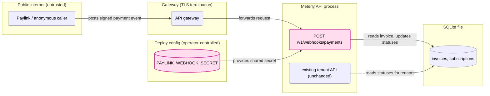
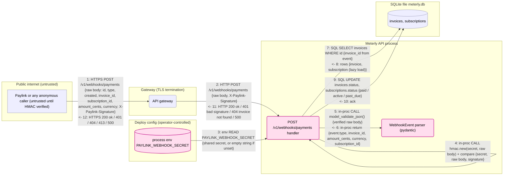
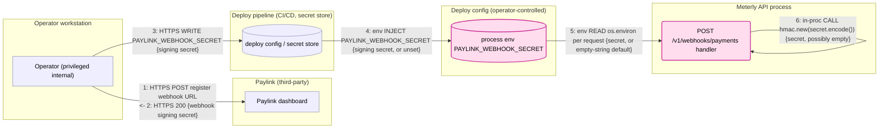

# Threat Model — Paylink payment webhook

## Scope

- **Mode:** diff
- **Base:** `main` → `feature/paylink-webhook`
- **Changed files:** `app/webhooks.py` (new), `app/schemas.py` (new), `app/main.py` (router mount)
- **Reference:** [`SPEC.md`](SPEC.md)

The change adds `POST /v1/webhooks/payments`, a public, unauthenticated (no API key) endpoint
mounted on the Meterly app (`app/main.py:8,11`). It reads the raw body, verifies an
HMAC-SHA256 in `X-Paylink-Signature` against a shared secret from env var
`PAYLINK_WEBHOOK_SECRET` (`app/webhooks.py:21-25`), parses the body into `WebhookEvent`
(`app/schemas.py`), looks up the invoice by `data.invoice_id` across all tenants, and on
`invoice.paid` sets the invoice `paid` and its subscription `active`, or on
`invoice.payment_failed` sets the subscription `past_due` (`app/webhooks.py:27-39`).
Trust-relevant surfaces: a new internet-facing endpoint outside tenant auth, crypto
verification with an env-provided secret, JSON deserialization, and cross-tenant writes to
the billing system of record. No new dependencies. The repo has no tests.

## Use Cases

| # | Use case | Primary actor | Phase |
|---|---|---|---|
| UC1 | Paylink (or anyone on the internet) posts a payment event; the handler verifies the HMAC, parses it, and marks the invoice paid / subscription active or past_due | Paylink / anonymous internet caller (tenant data relayed through Paylink) | In use |
| UC2 | Operator obtains the Paylink signing secret and provisions `PAYLINK_WEBHOOK_SECRET` into the running app | Operator | Deploy (and Admin / Ops: rotation) |

Phase sweep: **Deploy** → UC2. **In use** → UC1. **Admin / Ops** → secret rotation, folded
into UC2 (no other admin surface is added). **Decommission** → n/a: the change stores no new
data and adds no credentials beyond the shared secret; unregistering the endpoint at Paylink is
outside the change.

Use cases were identified and approved without a sign-off round, per the request.

## Use-Case Analysis

### UC1 — Paylink event delivery

| ID | Attacker | Attack | Impact | Severity | Status | Countermeasure | Verification |
|---|---|---|---|---|---|---|---|
| UC1:4-S, UC2:5-S | Anonymous internet | Chain: the endpoint is public with no API key (spec; `app/main.py:11`) → if `PAYLINK_WEBHOOK_SECRET` is unset or empty, `os.environ.get(..., "")` (`app/webhooks.py:22`) yields `""` and the handler computes HMAC-SHA256 with an empty key (`:23`) → the attacker computes the same `hmac.new(b"", body, sha256)` and sends it, passing `:24` → `db.get(Invoice, invoice_id)` with any tenant's id (`:28`) → `:32-34` set `paid`/`active`, or `:36` sets `past_due`, then `:38` commits. Nothing in the repo enforces the secret is set (no startup check). | Forge payment for any invoice of any tenant, or push any tenant's subscription to `past_due`: full integrity loss of the billing system of record (Critical) | Critical | [OPEN] | Fail closed at `app/webhooks.py:22`: load the secret once at startup and refuse to start (or return 500 from the handler) when it is missing or shorter than 32 bytes; never default to `""` | add: `tests/test_webhooks.py::test_rejects_when_secret_unset`, `::test_rejects_empty_key_signature`, `::test_rejects_bad_signature`; and confirm every environment sets a non-empty secret |
| UC1:2-D | Anonymous internet | `await request.body()` (`app/webhooks.py:21`) buffers the whole request body in memory before any signature check; Uvicorn sets no default body-size cap. A multi-GB POST (or several in parallel) exhausts process memory; each also costs a full HMAC pass (`:23`). | Meterly API process OOM or stalls: DoS of the single API component serving all tenants (Medium) | High | [OPEN] | Reject `Content-Length` above a small cap (e.g. 64 KiB) and stream-read with a hard cap before hashing, in `app/webhooks.py:21`; or enforce the cap at the gateway for this path | add: `tests/test_webhooks.py::test_oversized_body_rejected_413`; and confirm the gateway's body-size limit for `/v1/webhooks/payments` |
| UC1:9-Ta | Authenticated external user (tenant paying via Paylink; relayed fields) | The handler keys only on `event.data.invoice_id` (`app/webhooks.py:28`) and never compares `amount_cents`, `currency`, or `subscription_id` (`app/schemas.py:5-8`) with the stored invoice (`app/models.py:30-31`). A tenant who can shape their Paylink payment (partial or custom amount, or a checkout whose invoice reference they set) pays 1 cent against their 4900-cent invoice; Paylink genuinely signs `invoice.paid {invoice_id, amount_cents: 1}` and `:32-34` mark it `paid` and the subscription `active`. Rounded up on the relayed-field assumption (see Assumptions). | Service obtained without paying: integrity loss of important billing data / revenue (High) | High | [OPEN] | At `app/webhooks.py:32`, before any write, require `event.data.amount_cents == invoice.amount_cents`, `event.data.currency == invoice.currency`, and `event.data.subscription_id == invoice.subscription_id`; otherwise leave state unchanged and flag for review | add: `tests/test_webhooks.py::test_paid_amount_mismatch_rejected`, `::test_paid_currency_mismatch_rejected`, `::test_subscription_id_mismatch_rejected`; and confirm whether tenants can influence invoice id or amount at Paylink |
| UC1:9-X | Authenticated external user (tenant paying via Paylink; relayed fields) | No state-machine check: `invoice.paid` sets the invoice `paid` whatever its status (`void` included) and the subscription `active` whatever its status (`canceled` included) (`app/webhooks.py:32-34`); `invoice.payment_failed` sets `past_due` even if the invoice is already `paid` (`:35-36`); `event.created` is ignored, so out-of-order deliveries or Paylink retries apply last-writer-wins. A tenant with a canceled subscription pays a small or old invoice and gets the subscription reactivated. | Canceled subscription reactivated / void invoice marked paid, or a paid tenant pushed to `past_due`: integrity loss of important billing state (High) | High | [OPEN] | Explicit transition table in `app/webhooks.py:32-36`: `paid` only from `open`; subscription → `active` only from `trialing`/`past_due`, never from `canceled`; ignore `payment_failed` for an invoice already `paid`; ignore events whose `created` is older than the last applied event for that invoice | add: `tests/test_webhooks.py::test_paid_does_not_reactivate_canceled`, `::test_paid_on_void_invoice_ignored`, `::test_failed_after_paid_ignored` |
| UC1:9-Tb | Compromised trusted service (Paylink, or a holder of the leaked signing secret, see UC2:4-I) | The HMAC is the only control on the write (`app/webhooks.py:24`); anyone holding the secret can sign `invoice.paid` for any invoice of any tenant with matching amounts, and `:32-38` commit it with no out-of-band confirmation. | Arbitrary invoices marked paid across all tenants: full integrity loss of the billing system of record (Critical) | High | [OPEN] | Before applying `invoice.paid`, confirm the payment through Paylink's API (separate API credential) by event or payment id, so the webhook secret alone cannot mark invoices paid; alert on paid events without a matching Paylink payment | add: `tests/test_webhooks.py::test_paid_requires_confirmed_payment` (Paylink client mocked) |
| UC1:2-X | Adjacent service / network foothold (plaintext gateway→app hop, or gateway logs) | No replay protection: `event.id` is parsed (`app/schemas.py:12`) but never stored or checked, and `created` (`:14`) is never compared with the clock (`app/webhooks.py:27-38`). An attacker who captures one signed request on the post-TLS HTTP hop or in request logs replays it at will: an old `invoice.payment_failed` after the tenant has paid (`:36` → `past_due`), or an old `invoice.paid` for a since-voided invoice (`:33-34`). | A tenant's subscription flipped to `past_due` or reactivated on demand: tampering with important billing state (High) | Medium | [OPEN] | Persist processed `event.id` in a table with a unique constraint and skip duplicates in the same transaction as the update (`app/webhooks.py:27-38`); reject events whose `created` is outside a tolerance window (e.g. 5 min) | add: `tests/test_webhooks.py::test_duplicate_event_id_ignored`, `::test_stale_created_rejected`; and confirm whether the gateway→app hop is plaintext |
| UC1:9-R | Compromised trusted service (Paylink, or a holder of the leaked signing secret) | Statuses are overwritten in place (`app/webhooks.py:33-36`) and nothing records which event (id, type, created, amount, source) caused a change; a forged or replayed event is indistinguishable afterwards from a genuine one. | No durable record of billing state changes: durable repudiation of security-relevant events (High) | Medium | [OPEN] | Insert a `webhook_events` row (event id, type, invoice id, amount, received_at, body hash, outcome) in the same transaction as the update, and log each applied transition | add: `tests/test_webhooks.py::test_applied_event_is_recorded` |
| UC1:5-D | Compromised trusted service (Paylink) | After a valid signature, `WebhookEvent.model_validate_json(raw)` (`app/webhooks.py:27`) raises `ValidationError` on any unexpected shape (e.g. a new Paylink event type without `data.invoice_id`); it is not caught, so the handler returns 500. Paylink retries, and may eventually disable the endpoint, so later genuine events are missed. | Missed payment events for the endpoint: DoS of a single component (Medium) | Low | [OPEN] | Verify, then parse only the envelope (`id`, `type`); return 2xx for unhandled types and 400 for malformed known types, in `app/webhooks.py:27` | add: `tests/test_webhooks.py::test_unknown_event_type_acknowledged`, `::test_malformed_payload_returns_400` |

### UC2 — Provision the webhook secret

The unset-secret fail-open on edge 5 is one finding with UC1:4-S; see that row (`UC1:4-S, UC2:5-S`).

| ID | Attacker | Attack | Impact | Severity | Status | Countermeasure | Verification |
|---|---|---|---|---|---|---|---|
| UC2:4-I | Privileged internal user (CI/CD, support with env or log access) | The change takes the signing secret from a plain process env var (`app/webhooks.py:22`, spec). Env vars leak through `/proc/<pid>/environ`, container inspect, crash reports, and CI job logs that echo the environment; anyone who reads it can sign events (UC1:9-Tb). | Webhook signing secret disclosed (High) | Medium | [OPEN] | Inject the secret from the secret store at runtime (mounted file or secret-manager fetch) rather than baked into images or CI variables; restrict who can read the process environment; rotate on exposure | add: CI secret-scanning rule for `PAYLINK_WEBHOOK_SECRET` values in logs and images; and confirm how the deploy pipeline injects the secret |

## Findings Summary

**By Status:** 9 findings, all `[OPEN]` (no `[DONE]`: the repo has no tests, so no
countermeasure is verified).

**Un-closed by Severity:** Critical 1 · High 4 · Medium 3 · Low 1.

**Top fixes before merge**

1. **UC1:4-S, UC2:5-S** — fail closed when `PAYLINK_WEBHOOK_SECRET` is unset or empty
   (`app/webhooks.py:22`), with tests for bad and empty-key signatures.
2. **UC1:9-Ta / UC1:9-X** — check amount, currency, and subscription against the stored invoice,
   and enforce valid status transitions (no `void → paid`, no `canceled → active`).
3. **UC1:2-X / UC1:2-D** — dedupe on `event.id` with a freshness window, and cap the body size
   before hashing.

**Variants / out-of-change leads**

- `app/main.py:46-49` — `GET /v1/billing` selects the first subscription and the globally most
  recent invoice with no `tenant_id` filter, so every tenant sees another tenant's subscription
  and invoice. Pre-existing and untouched by the diff, but it is where the statuses this webhook
  writes are surfaced, so the webhook widens what leaks (live payment state).
- `app/auth.py:15` — tenant API keys are stored in plaintext and matched by SQL equality
  (pre-existing; the spec documents it). A DB read gives every tenant credential.

**Assumptions**

| Assumption | IDs it moves | How to confirm |
|---|---|---|
| `PAYLINK_WEBHOOK_SECRET` may be unset in some environment (nothing in the repo sets or checks it) | UC1:4-S, UC2:5-S: if every environment is confirmed to set a strong secret, the row is unreachable today, but stays open until the code fails closed | Inspect deploy config for each environment; add the startup check |
| Tenants can influence `invoice_id` or `amount_cents` on their Paylink payment (partial or custom amounts, customer-set references) | UC1:9-Ta, UC1:9-X: if Meterly creates fixed-amount checkouts server-side with non-editable invoice metadata, the attacker becomes Compromised trusted service (Low) → Medium | Paylink checkout / payment-link docs and Meterly's checkout creation code (not in this repo) |
| No gateway body-size limit applies to `/v1/webhooks/payments` | UC1:2-D: a small gateway cap drops it to Low | Gateway config |
| The gateway→app hop is plaintext HTTP and signed bodies may appear in gateway logs (spec: TLS terminates at the gateway) | UC1:2-X attacker persona | Network/gateway config and log settings |
| The endpoint is reachable from the whole internet with no gateway-level IP allowlist for Paylink (spec: "public, internet-reachable") | UC1:4-S, UC1:2-D exposure (an allowlist would lower both to Medium exposure) | Gateway config |
| Decisions made without asking: mode `diff`; slug `paylink_webhook` (given); use cases self-identified and treated as approved | — | — |

**Hardening**

- `app/webhooks.py:24` compares signatures with `!=`, not `hmac.compare_digest`. A remote
  timing oracle on a Python string compare through internet and gateway jitter is beyond
  practical, so it is not a finding; the fix is one line.
- Support two secrets during rotation (current and next) so rotating after a leak (UC2:4-I) does
  not drop genuine events while Paylink and Meterly are updated.
- The handler is `async def` but uses a synchronous SQLAlchemy session (`app/webhooks.py:16,28,38`),
  blocking the event loop during DB I/O; move the DB work to a threadpool.
