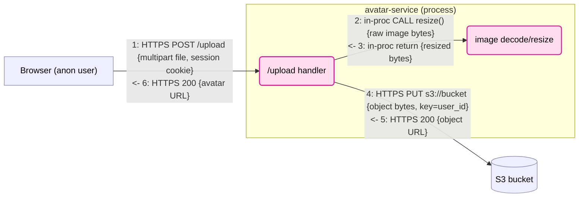

# DFD format

A DFD is a **Mermaid `flowchart`**. Its numbered edge labels are the edge inventory the
findings reference as `UC<n>:<N>`; there is no edge table. Two levels:

- **Context diagram (Level 0)**: one per model, drawn in Pass 0, orientation only.
- **Use-case DFD (Level 1)**: one per use case, drawn in Pass 2; STRIDE runs over it.

## Context diagram (Level 0)

The changed component and its **immediate neighbours** (the external entities, services, and
stores it talks to directly), with execution contexts as `subgraph`s.

- **The change in context, not the architecture.** Collapse anything the change doesn't touch
  into one node. If it reads like a system map, it has left scope.
- **No edge numbers, no STRIDE.** Label edges with plain words ("uploads file"). Numbers here
  collide with the use-case IDs and invite double analysis.
- Same node shapes, subgraphs, and scope colours as the use-case DFDs.

It bounds the model's scope, seeds the use cases (a node in no use case is out of scope or a
missed case), and shortlists adversaries (its external entities).

## Terminal view

A terminal can't render Mermaid, so chat never shows it; the Mermaid goes into the files.

- **Context diagram → box diagram** in a code block. Each execution context is a labelled box,
  stacked in flow order; nodes inside keep their shape marks (`[entity]`, `(process)`,
  `[(store)]`); flows are `│`/`▼` arrows with short labels; `*` marks `scope` nodes, with a
  one-line legend. Keep it within ~60 columns and align every box edge.
- **Use-case DFD → edge list**: each boundary with its nodes, then one line per numbered edge,
  returns included (`1: Browser → /upload handler: HTTPS POST {file, cookie}`).

```
┌─ Public internet (untrusted) ──────┐
│  [Browser (anon user)]             │
└─────┬──────────────────────────────┘
      │ HTTPS upload {file, cookie}
┌─────▼── avatar-service (process) ──┐
│  (/upload handler)*   (resize)*    │
└─────┬──────────────────────────────┘
      │ HTTPS PUT {object bytes}
┌─────▼── AWS account ───────────────┐
│  [(S3 bucket)]                     │
└────────────────────────────────────┘
 * in scope (new or changed); the rest are neighbours
```

## Node conventions

| DFD element | Mermaid shape | Example |
|---|---|---|
| External entity (outside our control) | rectangle | `Browser["Browser (anon user)"]` |
| Process (code that runs) | rounded | `API("API /upload handler")` |
| Data store | cylinder | `DB[("user_db")]` |
| Execution context | `subgraph` | see "Trust boundaries" |

Mark untrusted external entities (anonymous, third-party) in their label.

### Node granularity (what earns a node)

A process node is a **trust-relevant unit, not a function**; don't draw the call graph.
Collapse an in-process call chain into one node (or one `in-proc` self-edge on the handler)
**unless** a sub-step:

- **(a)** parses or deserializes untrusted input,
- **(b)** changes privilege or principal (drop privileges, `setuid`, assume role),
- **(c)** handles a secret, key, or crypto operation, or
- **(d)** is where a finding would attach.

Such a sub-step stays visible, as its own node or as an `in-proc` self-edge on its caller. In
the worked example, `decode/resize` is a node because it decodes untrusted bytes; a
same-process verify-and-parse step could instead be a self-edge on the handler.

## Scope colours

Shape carries element type; **colour carries scope, and nothing else**. Every DFD declares
both classes verbatim and assigns every node to exactly one:

```
classDef scope fill:#fde,stroke:#c39,stroke-width:2px,color:#000;
classDef neighbor fill:#eef,stroke:#88a,color:#000;
```

- **`scope`**: a node the change adds or modifies. The bold stroke keeps it readable in
  greyscale.
- **`neighbor`**: a pre-existing entity, service, or store the change talks to but doesn't
  modify.

Assign after the edges (`class API,Sign scope`, `class DB,Paylink neighbor`). Never add a
third colour or reuse the palette for another meaning; a diagram that seems to need one has
probably left scope.

## Trust boundaries = subgraphs

Each `subgraph` is one execution context. An edge inside one subgraph is in-context; an edge
leaving one crosses a trust boundary.

A **hosting context** (VPC, cloud account, cluster) is a subgraph that *contains* the app's
process subgraph: nest them, don't draw them side by side, and class it `neighbor`. Pass 3's
"who else can reach" check reads its co-inhabitants and administrators off this nesting.

### The same-execution-context test

An edge is in-context **only if** source and destination share the same OS process, the same
privilege level and principal, and the same address space (an in-process function or
library call). Everything else is a boundary:

- a network call of any kind, even to localhost or a sidecar;
- process ↔ database, queue, cache, or object store;
- across containers, pods, or hosts;
- an in-process privilege change;
- the edge that delivers attacker-influenced input (request body, file, runtime env).

When unsure, it's a boundary.

## Edge labels

Number edges per use case from 1 and label each:

```
N: PROTO VERB TARGET {data}
```

- **N**: the stable ID (`UC<n>:<N>`).
- **PROTO**: the channel (`HTTPS`, `HTTP`, `gRPC`, `AMQP`, `SQL`, `Redis`, `UDS`,
  `in-proc`, …). It is the **boundary verdict**: `in-proc` is in-context, anything else crosses
  a boundary. It must agree with the subgraph layout; a network PROTO inside one subgraph, or
  an `in-proc` edge leaving one, is a bug to fix.
- **VERB**: the operation (`POST`, `SELECT`, `PUBLISH`, `CONSUME`, `READ`, `WRITE`, `CALL`).
- **TARGET**: what it acts on (a path, table, queue, function). Omit it when the channel has
  none, as with a UDS.
- **{data}**: the security-relevant payload. Name what's sensitive or attacker-controlled
  (credentials, tokens, API keys, PII, file bytes, SQL or command strings, redirect URLs,
  signatures); collapse the benign rest ("request metadata"). Drop the braces when nothing
  is security-relevant.

The grammar bends to the channel (`UDS WRITE {bytes}`, `in-proc CALL resize() {image bytes}`,
`SQL SELECT customers {scope=vendor_id}`). A raw flow with no verb takes a plain data phrase.
Stay consistent within one model.

```
A -->|"1: HTTPS POST /login {creds: user, password}"| B
```

### Inserting an edge without renumbering

Once anything references an edge number (a finding, an issue, a review comment, a committed
diagram), it must keep pointing at the same edge. Insert a new edge with a **letter suffix**
on the edge it follows: `4a` between `4` and `5`, then `4b`. Finding IDs follow (`UC1:4a`).
Renumber from scratch only while nothing references the numbers yet.

### Removed edges

In review mode, an edge whose code is gone keeps its number. Draw it as a dashed arrow
labelled `removed: <original label>`
(`H -.->|"removed: 3: SQL UPDATE invoices {status}"| DB`). A removed return on a live forward
arrow stays on its line as `<- removed: N: …`; removing a forward edge removes its return.
The `removed:` prefix is the marker. Removed edges get no STRIDE and no findings, deliver no
data, and connect nothing (checklist items 1, 3, 5, 8); the skeptic's "boundary edge with no
findings" check skips them. A node left with only removed edges is prefixed `removed:` and
keeps its scope class.

## Return edges (responses)

A request/response pair is **two edges**, and the return is attack surface: verbose errors
and over-fetching (I), trusting an unverified response (S/T), parsing returned data (E),
amplification (D).

Write a same-channel return on the forward arrow's label, on a new line, as
`<- N: PROTO STATUS {data}` (STATUS: an HTTP status, `rows`, `ack`, `return`):

```
A -->|"1: HTTPS POST /login {creds: user, password}<br/><- 2: HTTPS 200 {session cookie} / 401 {error detail}"| B
```

- The return has its **own number** and is its own analysis unit. Added to an existing model,
  it takes the next suffix after its forward edge (`4a`).
- An out-of-band response (a redirect target, a callback, a bounce, an async result on
  another channel) takes its **own arrow**.
- **One-way channels have no return:** a fire-and-forget publish, a consumed queue message, a
  webhook you don't answer on the same channel. Point the edge the way the **data** travels
  (`Queue → Worker`, `AMQP CONSUME {task, token}`), even if the worker polls. A database or
  object-store **write** keeps its return (rowcount, `IntegrityError`, the stored URL).
- A benign return is still numbered ("200 OK", "ack"), so STRIDE dismisses it explicitly.

## Data provenance (no data from thin air)

Every security-relevant value an edge consumes traces to one of:

- a `{data}` item on an earlier inbound edge in the same use case,
- the authenticated principal (session, token), or
- deployment-controlled config.

A value consumed but delivered by no edge is **data from thin air**: add the edge that brings
it, label its origin, then analyse.

**The origin's trust travels with the value across every `in-proc` hop.** An `id` from the
request body is attacker-controlled where it scopes a query, not only where it arrives; that
is where IDOR and injection hide.

**Keep tracing past a trusted relay.** An edge from a trusted relay (a payment processor, an
IdP, a message queue, a partner API) authenticates the relay, not the author of every field.
Ask who originally supplied each value. If a less-trusted party can set or influence it
upstream (checkout metadata, a user-editable claim, a queue message built from user input),
it is that party's data and scores with that party (`scoring.md`, "Relayed fields"). When
neither the code nor the relay's documentation settles it, record it under Assumptions.

Track only the values worth naming in `{data}` (ids used for authz or scoping, keys, tokens,
amounts). It's a one-line check per value, not a lineage diagram.

## Sanity checklist (run before publishing a DFD)

STRIDE only walks the edges that exist, so check the structure first:

1. **No orphan or half-connected processes.** Every process has ≥1 inbound and ≥1 outbound
   edge; only external entities may originate flows with no inbound edge, and only stores and
   external entities may be pure sinks. An orphan means a skipped hop, or a node that should
   collapse into its caller. Removed edges don't count; `removed:` nodes are exempt.
2. **In-proc edges are drawn**, never omitted.
3. **Connected:** every node is reachable from the primary actor, following edges in either
   direction, removed edges excluded (`removed:` nodes exempt).
4. **Numbered in rough execution order**, returns where they occur; suffixes once referenced.
5. **Every edge numbered exactly once**: no number reused or skipped (suffixes aside; removed
   edges keep theirs), and every findings-table row points at an existing, non-removed edge.
6. **PROTO matches the subgraph layout.**
7. **Every node has exactly one scope class.**
8. **No data from thin air** (removed edges deliver none).

## Worked example

Use case: *Anonymous user uploads an avatar; service stores it and returns a URL.*



Six edges on three arrows: 3, 5, and 6 are returns. Edges 2 and 3 are in-process (no
boundary) but still drawn, or `Proc` would be orphaned. STRIDE runs over all six: edge 5 is
where a spoofed store response would surface, edge 6 where over-fetching or verbose errors
leak.

## Exporting to Excalidraw (optional)

Excalidraw can import the Mermaid ("Insert Mermaid diagram") for a hand-drawn look. The
Mermaid stays the source of truth.
