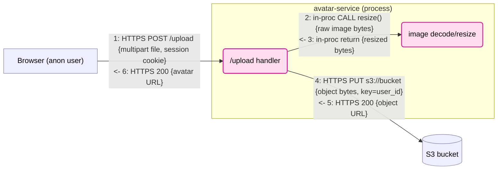

# DFD format

The canonical DFD is a **Mermaid `flowchart`**. It renders for humans and is plain text for
the STRIDE pass to reason over. Its **numbered edge labels are the authoritative edge
inventory** — the list the findings reference by `UC<n>:<N>`. There is no separate edge
table: each edge's data, channel, and direction live in its label, and the boundary verdict
is read off the label's PROTO (see below).

There are two levels of diagram:

- **Context diagram (Level 0)** — one per threat model, drawn in Pass 0. Orientation only.
- **Use-case DFD (Level 1)** — one per use case, drawn in Pass 2. The unit STRIDE runs over.

## Context diagram (Level 0)

A single high-level diagram, drawn in Pass 0, that orients the reader before the per-use-case
DFDs. It shows the **changed component plus its immediate neighbors** — the external
entities, services, and stores it directly talks to — with execution contexts as `subgraph`s. It is
the scaffold each use case later zooms into.

Rules:

- **The change in context, not the whole architecture.** Draw the changed component and its
  direct neighbors only. Collapse anything the change doesn't touch into a single node. If it
  reads like a full system map, it has left scope.
- **No edge numbers and no STRIDE.** This diagram is orientation only. Edge numbering
  (`UC<n>:<edge>`) and STRIDE analysis belong exclusively to the Level-1 use-case DFDs in
  Passes 2–3. Numbering the context diagram causes ID collisions and tempts double analysis.
- Label edges with plain direction/data words ("uploads file", "reads config") — no `N:` prefix.
- Use the same node shapes and `subgraph` execution contexts as the use-case DFDs (below), so the
  reader carries the same mental model into Pass 2.
- **Mark scope** with the canonical palette (see "Scope colours" below): every node is either
  `scope` (the change adds or modifies it) or `neighbor` (pre-existing). Encode it with the two
  pinned `classDef`s — *not* node shape, which already carries element type.

This diagram does three jobs downstream: (1) **scope** — the in-scope/neighbor split bounds the
whole model; (2) **use-case seed** — every node should land in ≥1 use case in the Pass 1 sweep (a
node in none is either out of scope or a missed case); (3) **adversary shortlist** — its external
entities are the candidate attacker personas Pass 3 scores.

## Node conventions

Use node shapes to carry DFD element type (helps both humans and the STRIDE pass):

| DFD element | Mermaid shape | Example |
|---|---|---|
| External entity (actor outside our control) | rectangle | `Browser["Browser (anon user)"]` |
| Process (code that runs) | rounded | `API("API /upload handler")` |
| Data store | cylinder | `DB[("user_db")]` |
| Execution context | `subgraph` | see below |

Annotate untrusted external entities (anon, third-party) in the label so exposure is
obvious at a glance.

### Node granularity (what earns a node)

A process node is a **trust-relevant unit, not a function.** This is the knob that controls
graph size: in-proc edges exist only *between the nodes you draw*, so you never render the call
graph — you draw the handful of units STRIDE has something to say about.

Collapse an in-process call chain into a **single node** (or a single `in-proc` self-edge on
the handler) **unless** a sub-step:

- **(a)** parses or deserializes untrusted input,
- **(b)** changes privilege or principal (drop priv, `setuid`, assume role),
- **(c)** handles a secret, key, or crypto operation, or
- **(d)** is where a finding would attach — the thing a countermeasure would guard.

A sub-step that hits one of these must stay **visible** — as its own node or as an `in-proc`
self-edge on the caller; either way, don't expand the calls behind it. Everything else stays
inside the caller. In the worked example below, image `decode/resize` is its own `Proc` node
because it decodes untrusted bytes (test (a)); a same-process signature-verify+parse step
(test (a)/(c)) could instead stay a single `in-proc` self-edge on the handler.

## Scope colours

Node **shape** carries element type; node **colour** carries scope. Every DFD — the Pass 0
context diagram and every Pass 2 use-case DFD — declares both classes and assigns **every node
to exactly one**, so a reviewer sees at a glance what the change introduces versus what was
already there. Colour is the scope channel and nothing else: never overload it to mean
something else (one model flipped the palette to mark external entities, and the reader can
then no longer trust any colour in the model).

Pin these two `classDef`s verbatim, so the same colour means the same thing in every diagram:

```
classDef scope fill:#fde,stroke:#c39,stroke-width:2px,color:#000;
classDef neighbor fill:#eef,stroke:#88a,color:#000;
```

- **`scope`** — a node the change adds or modifies. The bolder stroke makes it read as
  in-scope even in greyscale or for a colour-blind reader, so scope never rests on hue alone.
- **`neighbor`** — a pre-existing external entity, service, or store the change talks to but
  does not modify.
- `color:#000` keeps labels legible when a renderer uses a dark background.

Assign after the edges, e.g. `class API,Sign scope` then `class DB,Paylink neighbor`. Do not
add a third colour; if you reach for one, the diagram has probably left scope.

## Trust boundaries = subgraphs

Each `subgraph` is one execution context. An edge that stays inside one
subgraph is **in-context (no boundary)**. An edge that leaves a subgraph **crosses a
trust boundary**.

A **hosting context** (VPC, cloud account, cluster) is an execution-context subgraph too, and it
*contains* the change rather than sitting beside it — **nest** the app's process subgraph inside
it (Mermaid nests subgraphs), don't draw the two as siblings. Class it `neighbor`. Whoever
co-inhabits or administers the outer context can reach the nodes nested inside, which is what
Pass 3's co-reach check reads off.

### The same-execution-context test

Treat an edge as in-context (trusted, no boundary) **only if** source and destination
share *all* of:

- the same OS process (or same runtime/thread of execution), and
- the same privilege level / principal, and
- the same memory/address space — i.e. the call is an in-process function or library
  call, not a network, IPC, socket, pipe, or syscall-to-another-component hop.

Everything else is a boundary. Concretely:

- In-process function/library call, same privileges → **no boundary**.
- HTTP/gRPC/any network call, even to localhost or a sidecar → **boundary**.
- Process ↔ database, message queue, cache, object store → **boundary**.
- Across containers/pods/hosts → **boundary**.
- Crossing a privilege change in-process (drop priv, setuid, assume role) → **boundary**.
- Reading attacker-influenced input (request body, file, env at runtime) → the edge that
  *delivers* that input is a **boundary**.

Default to **boundary** whenever unsure. Most findings cluster on boundary-crossing edges.

## Edge numbering and labels

Number edges per use case starting at 1. The label is a **structured string** — the number,
then a compact grammar that names the channel, the operation, and the data:

```
N: PROTO VERB TARGET {data}
```

- **N** — the edge number. It is the stable ID; finding IDs reference it as `UC<n>:<N>`.
- **PROTO** — the channel the hop travels over: `HTTPS`, `HTTP`, `gRPC`, `AMQP`, `SQL`
  (or `pg-wire`), `Redis`, `UDS` (Unix-domain socket), `in-proc` (in-process call), … PROTO
  is the **trust-boundary tell**: anything other than `in-proc` is a network/IPC/store/socket
  hop and therefore a boundary (see the same-context test). It must agree with the **subgraph layout** —
  an `in-proc` edge stays inside one subgraph, any other PROTO leaves one — so the label
  and the drawing cross-check each other.
- **VERB** — the operation on that channel: HTTP `POST/GET/PUT/DELETE`, SQL
  `SELECT/INSERT/UPDATE/DELETE`, broker `PUBLISH/CONSUME`, socket/stream `READ/WRITE`, in-proc
  `CALL`.
- **TARGET** — what the verb acts on: an HTTP path, a table, a queue/topic, a function. Some
  channels have no endpoint beyond themselves — a UDS is just read and written, so the socket
  path *is* the target, or you drop it. Don't invent one; omit it when there isn't one.
- **{data}** — the security-relevant payload, in braces. Same "choose the data judiciously"
  rule as below: name the sensitive/attacker-controlled items, collapse the benign rest. Drop
  the braces entirely when an edge carries nothing security-relevant (a bare `ack`, `200 OK`).

**The grammar is a guide, not a rigid schema.** It is shaped after HTTP but bends to the
channel, and a human reading the edge can tell what fits: a UDS edge reads `UDS WRITE {bytes}`
with no endpoint; an in-process call reads `in-proc CALL resize() {image bytes}`; a DB read
reads `SQL SELECT customers {scope=vendor_id}`. When a hop genuinely has no verb/target — a
raw data flow from an external entity — fall back to a plain data phrase rather than
manufacturing ceremony. Keep whatever you choose consistent within one model.

```
A -->|"1: HTTPS POST /login {creds: user, password}"| B
```

### Inserting an edge without renumbering

Edge numbers are **stable IDs** — once anything references `UC1:4` (a finding, a filed
issue, a review comment, a committed diagram), that number must keep pointing at the
same edge forever. So when you discover an edge that belongs *between* two existing ones,
do **not** renumber the edges after it. Insert it with a **letter-suffixed number** on
the edge it follows:

- A new edge between `4` and `5` is `4a`; another after it is `4b`, then `4c`, …
- It sorts in flow order (`4 → 4a → 4b → 5`) yet leaves every later number — and every
  finding ID built on it — untouched.
- Finding IDs reference it the same way: `UC1:4a`.

This is the standard way to **add return edges to a model that was first drawn
forward-only**: each return is inserted right after its forward edge, so the return of
`4` becomes `4a` (the next free suffix if `4` already documents a same-channel
response). Renumber from scratch to close the gaps **only** while the model is still
unpublished and nothing references its numbers yet.

### Choosing the data judiciously

Fill `{data}` with what matters to security, not the whole schema:

- Name the sensitive/attacker-controlled items explicitly: credentials, session token,
  JWT, API key, PII, uploaded file bytes, SQL/command string, redirect URL, signature.
- Collapse benign payloads: "request metadata", "rendered HTML", "200 OK".
- If an edge carries both, name the sensitive part and summarize the rest.

## Return edges (responses)

Every request/response pair is **two** edges: the forward edge and its return. The
return crosses the same trust boundary in the opposite direction and is attack surface
in its own right — verbose errors and over-fetching (I), the caller trusting an
unverified or poisoned response (S/T), parsing data that comes *back* (E), response
amplification (D). Do not leave returns out, and do not skip them in the STRIDE pass.

To keep diagrams readable, don't draw a second arrow for a same-channel response.
Document the return on the forward edge's label, on a new line (`<br/>` in Mermaid),
prefixed `<- N:`. A return uses the same grammar with the **response** in place of
VERB+TARGET — `<- N: PROTO STATUS {data}`, where STATUS is the channel's response token
(an HTTP status, `rows`, `ack`, `return`):

```
A -->|"1: HTTPS POST /login {creds: user, password}<br/><- 2: HTTPS 200 {session cookie} / 401 {error detail}"| B
```

- The return gets its **own edge number** and is its **own analysis unit** — STRIDE walks
  forward and return edges separately, even though they share one drawn arrow. When you add
  returns to a model that was first drawn forward-only, insert each with the suffix convention
  (the return of `4` becomes `4a`) so flow order and existing finding IDs are both preserved —
  see "Inserting an edge without renumbering".
- Pair only true same-channel request/responses. An out-of-band "response" — a
  redirect target, a callback/webhook, an email bounce, an async result on a different
  channel — takes its **own arrow**: it is a different path with different boundaries.
- **One-way channels have no return.** A fire-and-forget publish, a pub/sub message a
  consumer pulls (`CONSUME`), or a webhook you don't reply to on the same channel is a
  single data flow — don't manufacture a return row for it. Point the edge the way the
  **data** travels, not the way the call was initiated: a queue handing a task to a worker
  is `Queue → Worker` labelled `AMQP CONSUME {task, token}`, even though the worker initiated
  the poll. A database or object-store **write** is *not* one-way, though — its return
  (rowcount, `IntegrityError`, the stored object's URL) is security-relevant attack surface,
  so it keeps its return edge.
- A return that carries nothing security-relevant still gets a numbered row; label it
  briefly ("200 OK", "ack") so the STRIDE pass dismisses it explicitly, not silently.

## The edge inventory

There is **no separate edge table.** The numbered Mermaid labels are the inventory the
STRIDE pass walks and the findings reference:

- **Data, channel, and operation** are in the label — `N: PROTO VERB TARGET {data}`.
- **Direction** is the arrow (From → To); a return is its own number on the same arrow.
- **The boundary verdict is read off PROTO**, not written in a column: `in-proc` ⇒ in-context
  (no boundary); any other protocol (`HTTPS`, `SQL`, `AMQP`, `UDS`, …) ⇒ crosses a boundary.
  This is why the diagram needs no `Crosses TB?` column — the label already carries it, and
  the subgraph layout must agree with it (a network-PROTO edge that stays inside one subgraph,
  or an `in-proc` edge that leaves one, is a bug to fix).

What was an edge-table row is now one numbered label; what was the `Crosses TB?` column is now
the PROTO token. The per-use-case **findings table** (schema in `SKILL.md` Pass 3) is the only
table in the model, and it references these edge numbers by `UC<n>:<N>`.

## Data provenance (no data from thin air)

A DFD reasons about data, so every security-relevant value an edge *consumes* must be traceable
to where it *entered*. Trace each such value back to one of:

- a `{data}` item on an earlier inbound edge in the same use case,
- the authenticated principal (session / token), or
- deployment-controlled config.

A value a query, check, or write consumes but that no earlier edge delivered is **data from thin
air**: the diagram is incomplete. Add the edge that introduces it, label its origin, then analyse
it.

**The origin's trust travels with the value, across every `in-proc` hop.** An `id` from the
request body is attacker-controlled where it scopes a query, not just where it arrives — which is
where IDOR and injection hide.

Track only the values already worth naming in `{data}` — ids used for authz/scoping, keys,
tokens, amounts — not every field. It is a one-line check ("can I point to where this came
from?"), not a separate lineage diagram.

## Sanity checklist (run before publishing a DFD)

A malformed graph silently corrupts everything downstream — STRIDE only walks the
edges that exist. Check structure before the STRIDE pass:

1. **No orphan or half-connected process nodes.** Every process has ≥1 inbound and
   ≥1 outbound edge. Only external entities may originate flows with no inbound; only
   stores and external entities may be pure sinks. An orphan means a hop between kept
   nodes was skipped — or the node never earned its place and should collapse back into
   its caller (see "Node granularity").
2. **In-proc edges are still edges.** "No trust boundary" is recorded by drawing the edge
   with an `in-proc` PROTO, never by omitting it. Omitting the hop orphans nodes and hides
   the data path.
3. **Connected.** Every node is reachable from the use case's primary actor by
   following edges (in either direction).
4. **Numbering follows the flow.** Number edges in rough execution order, returns
   included at the point in the flow where they occur. Renumber freely while the model
   is unpublished and nothing references its numbers; once finding IDs may be referenced
   (issues, review comments, a committed model), insert with letter suffixes (`4a`
   between `4` and `5`) instead of renumbering — see "Inserting an edge without
   renumbering" above.
5. **Every edge numbered exactly once.** No number is reused or skipped (letter suffixes
   aside), and every finding ID (`UC<n>:<N>`) points at an edge that exists in the diagram.
6. **PROTO matches the subgraph layout.** Each edge's PROTO agrees with whether it crosses
   a subgraph boundary — an `in-proc` edge stays within one subgraph, any network/IPC/store/
   socket PROTO crosses one. A mismatch (a network PROTO that stays inside a subgraph, or an
   `in-proc` edge that leaves one) means either a mislabelled protocol or a wrong boundary
   call; fix one.
7. **Every node has a scope class.** Each node is assigned exactly one of `scope` / `neighbor`
   (see "Scope colours"). An unclassed node is an undecided scope call, and a flipped or extra
   colour makes the whole model's colours untrustworthy.
8. **No data from thin air.** Every security-relevant value an edge consumes traces to an
   earlier inbound edge, the authenticated principal, or config (see "Data provenance"). A
   consumed value with no origin means a missing inbound edge — add it before the STRIDE pass.

## Worked example

Use case: *Anonymous user uploads an avatar; service stores it and returns a URL.*



Six edges drawn as three arrows: 3, 5, and 6 are returns, documented on their forward
arrows' labels but numbered separately. Edges 2 and 3 are
in-process (same process, same privilege) → no boundary, yet still drawn — omitting
them would leave `Proc` orphaned (checklist item 1). Everything crossing the `svc`
subgraph edge is a boundary. STRIDE then runs over edges 1–6, returns included: edge 5
is where a poisoned/spoofed store response would surface; edge 6 is where over-fetching
or verbose errors leak.

## Exporting to Excalidraw (optional)

If the user wants the hand-drawn look, the Mermaid can be imported into Excalidraw
(Excalidraw supports "Insert Mermaid diagram"). The Mermaid remains the
source of truth; the Excalidraw is a presentation copy.
