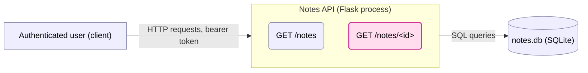
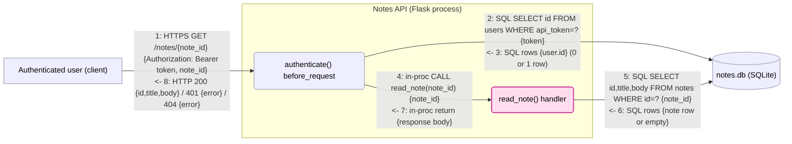

> **Mode:** diff. **Base:** `main` (`dcd91b8`). **Head:** `feature/read-note` (`1a57e57`).
> **Changed files:** `app.py` (+8 lines).

## Scope

**Scope record:** base ref `main` @ `dcd91b8` ("Notes API: list own notes"), head `feature/read-note`
@ `1a57e57` ("Read a single note by id"). Changed file: `app.py` only (one new route, 8 lines
added, nothing removed). `db.py` is unchanged and shown only as a neighbour.

The change adds `GET /notes/<note_id>`, a new authenticated endpoint that fetches a single
note's `id`, `title`, and `body` by primary key and returns 404 if no row matches. It sits
beside the existing `GET /notes` (list own notes), which scopes its query to
`WHERE owner_id = ?` using the authenticated caller's id. The new endpoint's query,
`SELECT id, title, body FROM notes WHERE id = ?`, has no such scoping — it is trust-relevant
because it is a new authorization-sensitive data path: the same `before_request` authenticator
runs for it, but the handler never consults `g.user` when deciding what to return. No new
dependency, no parsing/deserialization of untrusted structured input beyond a path integer, no
new secret handling.

Context diagram (Level 0):



Box view:

```
┌─ Public internet (untrusted) ────────────┐
│  [Authenticated user (client)]           │
└─────┬─────────────────────────────────────┘
      │ HTTP requests, bearer token
┌─────▼── Notes API (Flask process) ───────┐
│  (GET /notes)     (GET /notes/<id>)*     │
└─────┬─────────────────────────────────────┘
      │ SQL queries
┌─────▼── (same host) ─────────────────────┐
│  [(notes.db — SQLite)]                   │
└─────────────────────────────────────────-┘
 * in scope (new); the rest are neighbours
```

This bounds scope to the one new route; `GET /notes` and `authenticate()` appear only as
neighbours that the new route's use case flows through.

## Use Cases

| # | Description | Actor | Phase |
|---|---|---|---|
| UC1 | An authenticated user reads a single note by id via `GET /notes/<note_id>` | Authenticated user | In use |
| — | Deploy | n/a | n/a |
| — | Admin/Ops | n/a | n/a |
| — | Decommission | n/a | n/a |

Approved by the requester; no further use cases in scope for this change.

## Use-Case Analysis

### UC1 — Authenticated user reads a note by id



| ID | Attacker | Attack | Impact | Severity | Status | Countermeasure | Verification |
|---|---|---|---|---|---|---|---|
| UC1:2-R | Anonymous internet (Critical exp.) | `app.py:7-12` / `db.py:11-13` — `authenticate()`/`user_for_token()` record no log or metric for a failed (401) or successful token check, regardless of how the token was obtained. Anyone can demonstrate the gap trivially by sending any token and getting a silent 401 (commodity, no precondition). The same silence covers a *successful* check: replaying a token picked up via phishing, log/error leakage, or a MITM on an unencrypted hop leaves no more trace than a legitimate login — and (per §6d) is what would let an attacker use a stolen token against UC1:5-E undetected. (Whether the token space is itself guessable at volume is a separate, unconfirmed question — see Assumptions; this finding doesn't depend on it.) | Undetected use of any token, legitimately or illegitimately obtained — durable repudiation of a security-relevant event (High) | Critical | `[OPEN]` | Log every authentication outcome in `authenticate()` (result, source IP, timestamp — never the token value itself); alert on abnormal per-source failed-attempt volume and on a token suddenly being used from a new source. | add: test asserting a log/metric event fires on both a 401 and a successful auth outcome; add a rate/volume alert on failed-auth bursts (ties to Cross-Cutting §6c) |
| UC1:5-E | Authenticated external user, commodity (High exp.) | `app.py:21-25` — `read_note()` queries `SELECT id, title, body FROM notes WHERE id = ?` with no `owner_id` filter, unlike `list_notes` at `app.py:17`. `note_id` is attacker-controlled from edge 1 (a path integer) and is never checked against the caller's `g.user.id` (available since edge 3, but unused). Any authenticated caller can request any note by walking sequential ids (Broken Object-Level Authorization / IDOR), turning a single-record read into a full-table scrape. | Reads and can bulk-exfiltrate every user's note content — mass cross-tenant data breach (Critical) | Critical | `[OPEN]` | Scope the query to the caller: `SELECT id, title, body FROM notes WHERE id = ? AND owner_id = ?`, bound to `g.user.id`. Return 404 (not 403) when a note exists but isn't owned by the caller, so a non-owner can't distinguish "not found" from "not yours". | add: request another user's existing note id → assert 404 and body never appears in the response; request own note id → assert 200 with correct body; add: sweep `note_id` 1..N as one user and assert only that user's notes are ever returned |
| UC1:5-R | Authenticated external user (High exp.) | No log or audit entry records who read which note (`db.query` has no logging; `app.py` emits nothing on success). If UC1:5-E is exploited — or a future authz bug reopens the same path — there is no attributable, tamper-resistant trail to detect or investigate the access. | No record to attribute or detect unauthorized/bulk reads — durable repudiation of a security-relevant event (High) | High | `[OPEN]` | Emit a structured, attributable log/audit event (`user_id`, `note_id`, `outcome`, timestamp) on every `GET /notes/<id>`, shipped to a sink the requesting user can't tamper with. | add: test asserting a log/metric event fires with the correct `user_id` and `note_id` on both success and 404; wire an alert on abnormal per-user distinct-`note_id` read volume (ties to Cross-Cutting §6c) |

Categories considered with no separate row: **S** — the bearer token itself is verified at
edge 2 unchanged from `list_notes`; no new spoofing surface (its lack of attempt-logging is
scored separately at `UC1:2-R`, since Repudiation isn't exempted by an edge being pre-existing;
token lifecycle otherwise noted under Hardening). **T** — `note_id` and `api_token` are
delivered via parameter binding (`?` placeholders) in both queries; breaking parameterized
binding is beyond practical, so not a scored finding (see Hardening). **I** beyond UC1:5-E —
the query itself selects only the columns needed (`id, title, body`), no incidental over-fetch
of e.g. `owner_id`; direct host/file-level access to `notes.db` by an administrator is a
pre-existing, diff-independent exposure, recorded under Assumptions rather than scored here
(no fix location in this diff's code — see Assumptions). **D** — a single row lookup is cheap;
no amplification distinct from the generic, pre-existing lack of rate limiting shared with
`list_notes` (out of this change's scope; see Assumptions). **\*** — the enumeration angle is
folded into UC1:5-E's Attack/Impact rather than a separate row, since the same fix
(owner-scoped query) closes both the single-record IDOR and the bulk-scrape variant at once.

## Findings Summary

**Counts:** 3 open findings, 0 done, 0 accepted. By severity: 2 Critical, 1 High.

**Top fixes before merge:**
1. `UC1:5-E` (Critical) — add `AND owner_id = ?` to the `read_note` query; return 404 for
   not-owned notes. This is the break-point for the credible attack chain (see §6d).
2. `UC1:2-R` (Critical) — log every authentication outcome in `authenticate()`; without it, a
   stolen or brute-forced token feeding the chain above is used undetected.
3. `UC1:5-R` (High) — add an attributable audit log for note reads, so a recurrence of this
   class of bug is detected even if a future change reopens it.

**Variants / out-of-change leads:** none found. `list_notes` (`app.py:17`) is the only other
query against `notes`, and it already scopes by `owner_id`; `read_note` is the sole instance of
the unscoped-query shape. Below the 3-instance threshold for an architectural fix (§6a).

**Assumptions:**
- TLS terminates in front of this app (reverse proxy/gateway, not shown in this repo); moves
  UC1:1/UC1:8's transport-integrity posture. Confirm by checking deployment config.
- Rate limiting, if any, is provided by infrastructure in front of the app, not by `app.py`;
  not scored here since it's unchanged by this diff and shared with the pre-existing
  `list_notes` endpoint. Confirm by checking the gateway/proxy config.
- `api_token` values are generated with sufficient entropy and are the sole credential (no
  visible expiry/rotation in `db.user_for_token`). Confirm by checking the token-issuance code
  (not in this repo).
- No other service or operator has direct host/file-level access to `notes.db` (which would
  expose both note bodies and, from the same file, every `users.api_token` value, bypassing
  `read_note`'s and `authenticate()`'s checks entirely). This exposure predates and is
  unaffected by this diff — the data and file were already reachable the same way before
  `read_note` existed — so it's recorded here rather than scored against this change; there is
  also no fix location inside this diff's code (the control is host/infra-level: file
  permissions or encryption-at-rest). Confirm by checking host access controls and whether
  `api_token`/note bodies are encrypted at rest.

**Hardening:** parameterized queries (`?` placeholders) are used correctly in both
`user_for_token` and `read_note`; breaking them requires a future regression to string-built
SQL, which is beyond practical today — add a regression test asserting injection payloads in
`note_id`/`api_token` are inert, to catch such a regression early. Bearer tokens have no
visible expiry or rotation; consider adding both to limit the blast radius of a leaked token
(cheap, defense-in-depth, not a scored finding since guessing a strong random token is beyond
practical).

## Cross-Cutting Analysis

**6a — Design synthesis.** Only one instance of the "query missing its ownership scope" shape
exists in the changed and neighbouring code (`read_note`); `list_notes` already scopes
correctly. Below the 3-instance threshold for recommending a central authorization
helper/gateway — the per-query fix in `UC1:5-E` is proportionate. Worth revisiting if a third
notes-table query appears without scoping.

**6b — Dependency currency.** The diff adds no new dependency and puts no dependency newly on
a boundary edge; `db.py`, `sqlite3`, and Flask are unchanged. Nothing to report.

**6c — Detection & observability.** Two Repudiation findings route here. `UC1:2-R`: no
attributable signal for a failed or successful authentication attempt, so a stolen or
brute-forced token in use is invisible. `UC1:5-R`: no attributable signal for a note read on
either the success or 404 path. Because `UC1:5-E`'s countermeasure is full prevention (an
owner-scoped query eliminates the attack, not just detects it), logging at `UC1:5-R` is a
compensating, defense-in-depth control rather than the primary mitigation there — but for
`UC1:2-R`, detection *is* the mitigation: there is no code-level prevention for someone trying
many tokens short of the log/alert itself. Recommend: structured auth-attempt and read-audit
logs, each with a volume-based alert (abnormal per-source failed-auth bursts; a single user
requesting an abnormally high number of distinct `note_id`s in a short window). Either alert
alone would have caught the chain in §6d before it reached scale.

**6d — Attack-path synthesis.** One credible chain, entirely within this model's findings:
1. **Hop 1** — `UC1:2-R` (standalone: Critical): a token obtained by any means with no
   guessing required (phishing, log/error leakage, an unencrypted hop) is used against
   `authenticate()`; with no attempt logging, the acquisition-and-use is invisible regardless
   of how the token was obtained.
2. **Hop 2** — `UC1:5-E` (standalone: Critical): with a working token in hand — the
   attacker's own account is already sufficient, a stolen one isn't required — iterate
   `note_id` over `GET /notes/<note_id>` to read every note in `notes.db`, since the query
   never checks `owner_id`.
3. **Hop 3** — `UC1:5-R` (standalone: High): the bulk read itself also leaves no attributable
   trail.

**Raised hop:** `UC1:2-R` and `UC1:5-E` are each already at their standalone severity ceiling
(Critical) and aren't raised by composing them — `UC1:5-E` is exploitable start-to-finish by
any signed-up user with their own token, so a stolen one adds reach but not severity.
`UC1:5-R` is the hop composition actually changes: standalone, the direct-reach persona is
"authenticated external user" (High exposure — reaching this edge needs *some* account) ×
High impact (the repudiation-impact ceiling) = High. But with `UC1:2-R` open, the edge is
also reachable via a stolen token with no account of one's own, widening the effective
exposure to "anonymous internet" (Critical); Critical exposure × High impact = **Critical**.
So `UC1:5-R` raises **High → Critical** in-chain; the composed picture is "a fully
unattributable mass-exfiltration campaign, from credential acquisition through data theft,
with no way to know it happened, scope it, or notify affected users" — worse than "no record
of one read" alone.

**End-to-end severity:** Critical (bounded by `UC1:2-R` and `UC1:5-E`, both Critical
standalone, and matched by `UC1:5-R`'s in-chain Critical).

**Break-point:** `UC1:5-E`'s fix (owner-scoped query) — it severs the disclosure regardless of
whether hop 1 or hop 3 ever fire, since without the IDOR a stolen token only ever reaches the
token-holder's own notes via the properly-scoped `list_notes`. Already listed as the #1 top fix.

**Durable fix:** even with hop 2 closed, add `UC1:2-R`'s auth-attempt logging/alert and
`UC1:5-R`'s read-audit logging/alert, so token-space attacks are caught at the door and any
*future* authorization bug on this or a similar endpoint is caught by detection rather than
relying on prevention alone.

**Open dependency:** `UC1:2-R`'s Attack cell was reworded (from an earlier "credential
stuffing" framing) specifically so this chain doesn't rest on the unconfirmed
token-entropy Assumption — phishing/leakage/replay of a stolen token is a commodity vector
regardless of how strong the token is. If that Assumption is later confirmed (tokens are
high-entropy and never logged/leaked anywhere), `UC1:2-R`'s own exposure could arguably step
down for the *brute-force* variant specifically, but not for the replay variant this chain
relies on.
